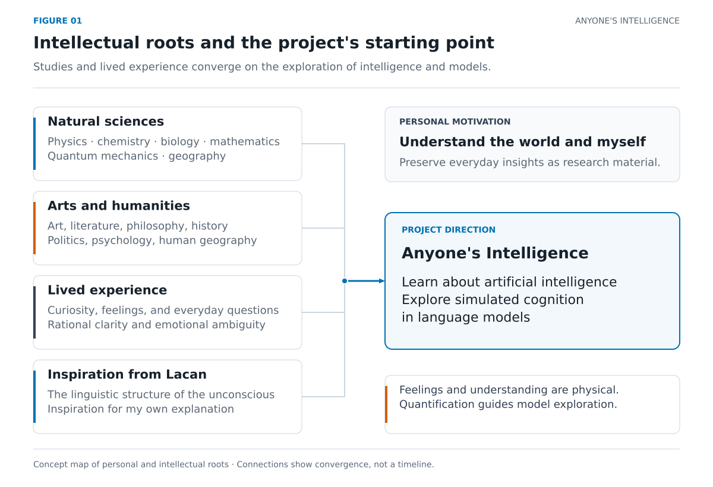
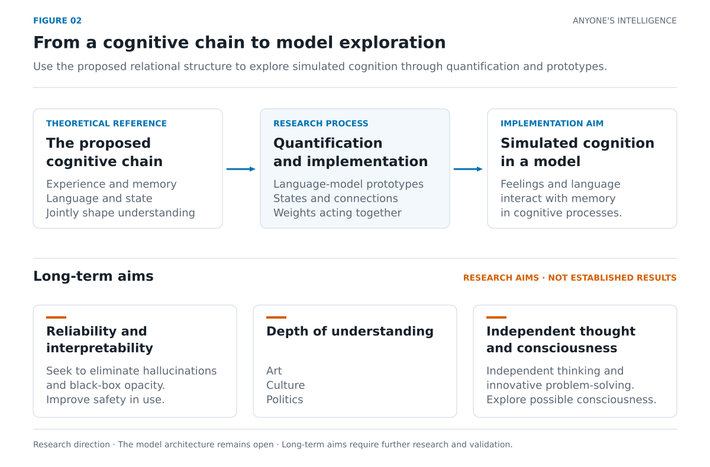
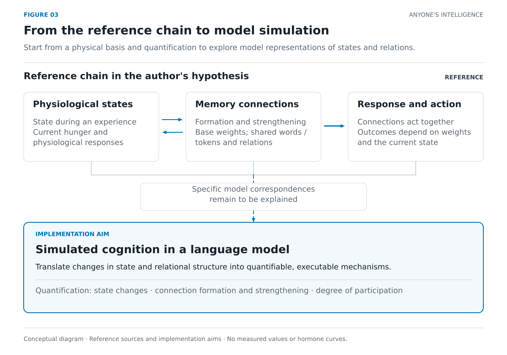
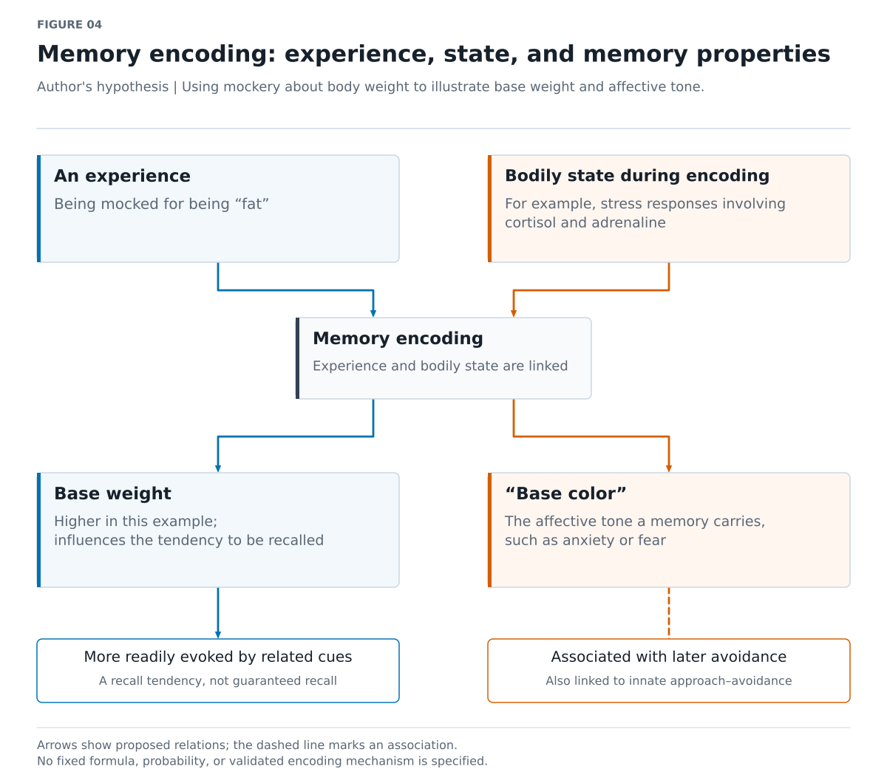
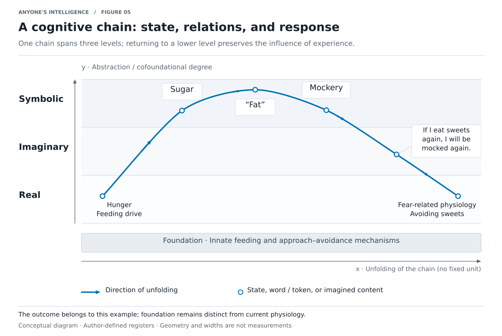
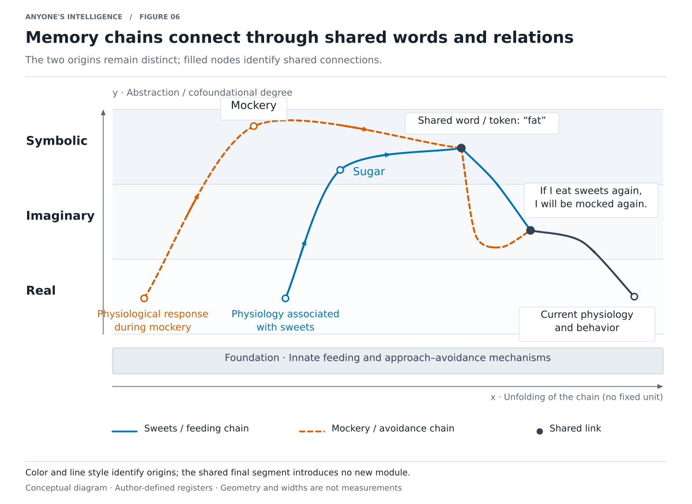
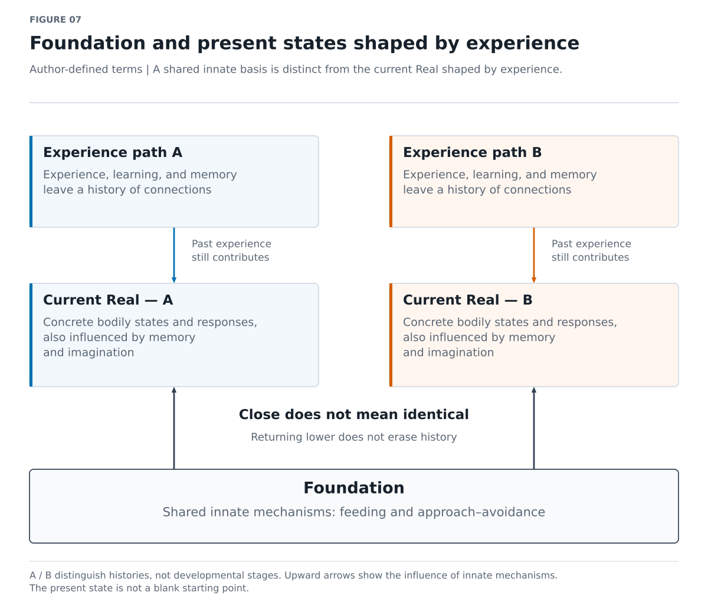
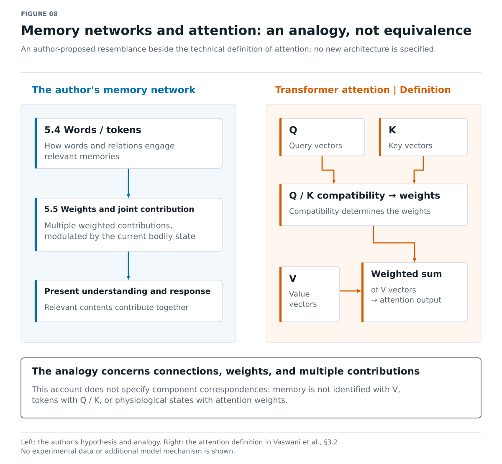
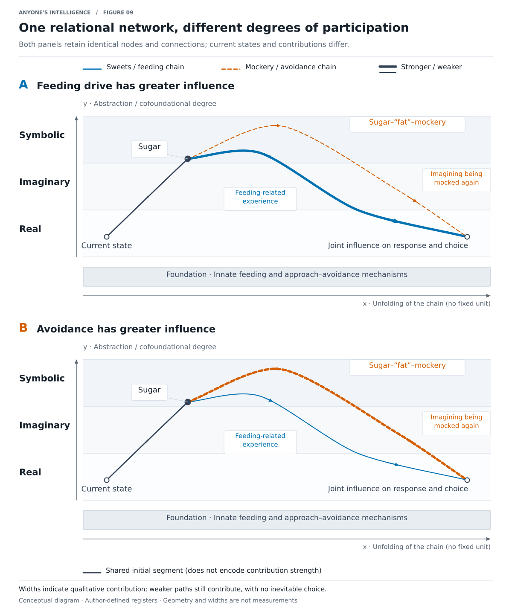

# Anyone's Intelligence

**English** | [简体中文](zh-CN.md)

**Version 1.0.0** · Recorded: **2026-11-07 02:26:49 PST (UTC−08:00)**

Documentation version · America/Los_Angeles · [Version history](../../CHANGELOG.md)

## 1 Abstract

**【Research aim】**

### Key points

- **What I want to study**
  - Learn about artificial intelligence and use my proposed cognitive chain as a reference for language-model prototypes that simulate cognition.
  - Draw inspiration from the philosophy of language, linguistics, and Lacanian psychoanalysis to develop my own theory and attempt to implement it in a new kind of language model.
  - Work toward reliable understanding, deeper understanding of art, culture, and politics, independent thinking, and innovative problem-solving.
  - Explore the possibility of consciousness in models and ways to eliminate hallucinations and black-box opacity.
- **【Philosophical position / Author's hypothesis】My starting point**
  - Feelings, memory, understanding, and the effects of language in society must ultimately be traced back to the physical world.
  - Quantification is central to translating this chain into model mechanisms, including changes in state and how memory connections form, strengthen, and contribute.
- **【Author's hypothesis】The chain I propose**
  - Begin with innate mechanisms and establish connections through experience, learning, and memory.
  - Words and relations connect different memories. Memory weights and the current physiological state jointly influence how much each connection contributes.
  - Feelings and language continually influence one another. This interaction forms understanding and ultimately leads back to physiological responses and behavior.
- **【Imagination / analogy】How I picture it**
  - The x-axis represents the unfolding of a chain. Higher positions on the y-axis are more abstract and more cofoundational.
  - Multiple curves begin at a low level, rise, intersect, and return to a low level. I borrow the names of three registers to describe these levels, and this network also strikes me as very much like a Transformer.

### Narrative

Anyone's Intelligence is my project for learning about artificial intelligence and exploring simulated cognition in language models. Drawing inspiration from the philosophy of language, linguistics, and Lacanian psychoanalysis, I hope to develop my own theory through study and research, use my proposed cognitive chain to guide language-model prototypes, and explore AI that is more reliable and easier to understand.

**【Philosophical position / Author's hypothesis】** I believe that feelings and understanding must ultimately be traced back to the physical world. I want to construct or simulate a chain that starts with innate mechanisms and bodily states, passes through experience, memory, language, and abstract relations, and returns to the body and behavior. My research focuses on using this chain as a reference, translating its changes in state and relational structure into quantifiable model mechanisms, and exploring how to implement simulated cognition.

**【Imagination / analogy】** I picture a network of curves that rise, fall, and intersect. It reminds me of linguistic structure and of the Transformer. The sections below first explain where these ideas came from, then develop my hypothesis step by step.

> **How to read this page:** “Imagination / analogy” preserves intuitions and metaphors without asserting equivalence. “Author's hypothesis” identifies the mechanisms and project-specific definitions I propose. “Scholarly note” presents sourced theories, technical definitions, or empirical observations; it does not automatically imply scholarly consensus or validation of my hypothesis. A label beneath a heading applies to that section unless a local label says otherwise. The label “Imagination / analogy” is distinct from the Imaginary in the theory.
>
> All figures are conceptual illustrations, not measurements or simulation results. There are currently no experimental findings that validate the hypothesis as a whole.

## 2 My personal account

**【Personal account】**

### Key points

- **I have wanted to understand the world since childhood**
  - I explored physics, chemistry, biology, mathematics, quantum mechanics, and geography to build a rational understanding of the world.
  - I also studied art history, art, philosophy, literature, history, politics, psychology, and human geography.
- **Why I keep learning**
  - I have explored many subjects without studying every one in depth.
  - My strongest motivation is a fear of “going through life without understanding it,” more than the ambition to master one problem and achieve something in a single field.
- **Two kinds of experience, and a sense of division**
  - I enjoy quantification, logic, and causal explanation, as well as the emotion and ambiguity that the arts and humanities bring.
  - I believe the world is physical, yet I always encounter it as an “I” with a body and feelings.
  - **【Imagination / analogy】** “A rational virtual machine running on an affective system” is my metaphor for this division.
- **The turning point Lacan offered**
  - “The linguistic structure of the unconscious” suggested a way to connect these experiences.
  - I want to develop my own theory from this inspiration.
- **Research priorities and personal motivation**
  - My priority is learning about AI and looking outward to study intelligence and language models.
  - Looking inward to understand myself is a personal motivation that accompanies the research.
  - I want to record insights, observations, and questions from everyday life and gradually develop them into research material.

### Narrative

I have been curious since childhood and have wanted to understand the world. I studied physics, chemistry, biology, mathematics, quantum mechanics, and geography, trying to build a rational understanding of it. I also studied art history, art, philosophy, literature, history, politics, psychology, and human geography. I have explored all these areas and formed some initial understanding, but I have not studied every subject in great depth.

Perhaps what drives me most is a fear of “going through life without understanding it,” more than the ambition to focus on one problem and achieve something in a single field. I enjoy the clarity of a rational world: things can be quantified, logical relationships can be identified, and causes can be investigated. I also enjoy the ambiguity, mixed with emotion, that comes from art, the humanities, and what I loosely call “metaphysical knowledge.”

**【Philosophical position】** I have always understood the world as physical. I therefore believe that even what feels emotional, ambiguous, or difficult to articulate should ultimately admit some form of causal explanation and quantification. Yet the one encountering the world is always “I”: someone with a body, emotions, and a history of their own. **【Imagination / analogy】** “A rational virtual machine running on an affective system” expresses the division I once felt and my uncertainty about it.

When I encountered philosophy, especially Lacanian psychoanalysis and its account of the unconscious and linguistic structure, I suddenly saw a possible connection. Feelings, language, and the body seemed traceable along a chain. I hope to follow this inspiration and develop my own explanation.

I know that artificial intelligence is the result of many people's collective work and dedication. On my own, I am very unlikely to achieve a goal as ambitious as “bringing an AI with cognition into existence.” Still, I want to learn about AI and look outward to study how intelligence forms and how models can be implemented. Looking inward to understand myself is a personal motivation alongside that work. A new understanding of an event, a sudden connection, or a feeling I cannot make sense of is worth preserving, both for later reflection and organization and for collaborators and AI assistants to read.

**【Personal account / Conceptual organization】** Figure 1 organizes the sources of my learning and reflection and their convergence on AI research; it is not a dated timeline. [Editable source](../../assets/figures/en/01_intellectual_roots.drawio)

## 3 How I understand Anyone's Intelligence

**【Research aim】**

### Key points

- **Learning about AI is the main thread**
  - Study AI and language models, and explore prototype implementations.
  - Use my proposed cognitive chain as a reference for exploring simulated cognition through quantification and model implementation.
  - On that basis, explore language-model representations, learning, and operating mechanisms.
- **My long-term aims**
  - Enable reliable understanding, reduce hallucinations, and ultimately attempt to eliminate them.
  - Make model operation understandable and inspectable, progressively eliminate black-box opacity, and improve safety in use.
  - Explore the possibility of models developing “consciousness” and a deep understanding of art, culture, and politics.
  - Explore independent thinking and the ability to propose innovative solutions.
- **Questions the model should address**
  - How can a model simulate the interaction between feelings and language, and the contribution of memory to understanding?
  - How can the relationships between state, memory, and choice in this chain be translated into model mechanisms?
  - **【Imagination / analogy】** The Transformer offers a reference for networks and weights; the final architecture remains open.
- **Development boundaries**
  - Prototypes should operate offline by default, with restrictions on network access and local agent capabilities.
  - These are design requirements. Actual permission controls still need to be implemented and verified.

### Narrative

For me, Anyone's Intelligence is first a project for learning about AI and studying language models. Its central direction is to use my proposed cognitive chain as a reference for implementing simulated cognition in a language model. I hope to translate the formation of connections, differences in weight, and effects of state into quantifiable, executable model mechanisms, then use prototypes to explore how they jointly contribute to cognition.

I want the model to understand, eliminate hallucinations, make its internal operation easier to inspect, and progressively eliminate black-box opacity. I also want it to understand art, culture, and politics in depth, think independently, propose innovative solutions, and open up the possibility of “consciousness.” These are long-term aims. A model's fluent explanation of itself does not establish that it is conscious or that its explanation faithfully represents its internal mechanisms.

**【Imagination / analogy】** The Transformer gives me a reference for expressing networks and weights, but I have not selected it as the project's architecture. **【Research aim】** Development must also account for safety: prototypes should be offline by default, with network access and local agent capabilities restricted through actual permission controls and verification.

**【Research aim / Conceptual organization】** Figure 2 distinguishes inspiration, quantification and prototype implementation, and long-term aims. Arrows indicate research direction, not achieved capabilities. [Editable source](../../assets/figures/en/02_research_direction.drawio)

## 4 Why I believe quantification is possible

**【Philosophical position / Author's hypothesis】**

### Key points

- **My physicalist starting point**
  - Feelings and understanding occur in the physical world and should ultimately admit some form of causal explanation and quantification.
  - Language and social judgments also affect physiology through experience, learning, and memory.
- **The causal chain I want to construct or simulate**
  - Experiences or inputs produce physiological changes that contribute to memory encoding and the formation of associative structures.
  - Later inputs evoke memories through existing connections, influencing the current physiological state and behavioral choice.
- **Two examples of how physiological responses contribute to memory**
  - **When eating sweets:** A preference for sugar and the physiological responses to eating contribute to the formation of related memories. I use changes in dopamine to illustrate this process.
  - **When mocked for being fat:** The stress response contributes to memory encoding. In my hypothesis, physiological changes involving cortisol and adrenaline increase the memory's base weight, making it easier to recall through association later.
- **Quantification for model implementation**
  - Aim: use this chain and its relational structure as a reference for implementing simulated cognition in a model.
  - States: draw on the roles of physiology during an experience and in the present to explore representations and changes of state in the model.
  - Associative structures: quantify how memories connect, how connections form and strengthen, and how much each contributes.
  - Specific model correspondences, quantification methods, and implementation details are not developed in this account.

### Narrative

I believe that feelings and understanding must ultimately be traced back to the physical world, so quantification is central to this research. In my hypothesis, descriptions such as “liking,” “fear,” and “avoidance” can be traced to physiological processes, while language and social judgments act on the body through the associative structure of memory. This chain provides a reference for simulated cognition in a model: I hope to translate its changes in state and relational structure into quantifiable, executable mechanisms.

Eating sweets was my initial example. Imagine someone who likes sweets: eating is accompanied by physiological changes, such as changes in dopamine, and memories form. This person has also been mocked for being fat, connecting that experience to the accompanying bodily responses. Later, on hearing “sweets make you fat,” the word “fat” may evoke the earlier memory, produce fear and avoidance, and lead them not to eat the sweet. Through experience, learning, and memory, language in society enters the physical causal chain I want to trace.

I use dopamine, cortisol, and adrenaline to make this idea concrete, not to present these simplified examples as established physiological laws. “The higher a hormone level, the stronger the memory” cannot simply be treated as a universal conclusion. These physiological mechanisms provide a reference for modeling; my research focuses on drawing on this chain and its relational structure to implement simulated cognition in a language model.

Associative structures are also central to quantification. Why does a word make a particular experience easier to recall? Why can the same information affect different people differently, or affect the same person differently in different states? These questions offer clues for modeling. I hope to use the way connections form, strengthen, and contribute under changing states as a reference for simulating this chain in a model.

**【Author's hypothesis / Modeling direction】** Figure 3 places the reference chain alongside the intended model simulation. Specific representations, functions, and component correspondences remain to be explained. [Editable source](../../assets/figures/en/03_chain_to_model.drawio)

## 5 My theory, step by step

### 5.1 The innate foundation

**【Author's hypothesis】**

#### Key points

- **Meaning and role**
  - Foundation consists of innate mechanisms with genetic and physiological bases, such as feeding and seeking benefit while avoiding harm.
  - It provides the basis on which later experiences influence behavior. Its drives do not derive entirely from recalling other memories.
- **Its relationship to acquired experience**
  - Seeking benefit and avoiding harm have an innate basis.
  - Which particular things are approached or avoided can be influenced by learning and memory.

#### Narrative

In my hypothesis, foundation refers to innate mechanisms with genetic and physiological bases. Hunger drives feeding, and tendencies to seek benefit and avoid harm influence responses. These provide the basis on which acquired experience acts; not every drive must first be explained through another memory.

In the sweets example, avoiding pain has an innate basis, whereas the association between sweets and something to avoid involves acquired experience. I hope to draw on the joint action of these foundational mechanisms, learning, and memory to implement simulated cognition in a model.

### 5.2 Forming understanding through existing memories

**【Author's hypothesis】**

#### Key points

- **Understanding and Cofoundational knowledge**
  - Understanding something requires explaining it through other memories.
  - I use Cofoundational knowledge to describe this process of forming explanations through existing memories and connections.
  - This is my use of the term within the project, not a definitive account of an established term in the literature.
- **The interaction between feelings and language**
  - A word can connect a past experience to the current situation and change how someone feels.
  - Feelings, in turn, influence which contents are more likely to contribute to understanding, allowing new understanding to form.

#### Narrative

When I understand something, I need to draw on other memories and find connections that can explain it. I use Cofoundational knowledge to express this process: new information is interpreted through existing connections, and existing memories contribute to a new understanding.

Feelings and language continually influence one another. A word connects a past experience to what is happening now, changing the current feeling; that feeling then influences which contents are more likely to contribute to understanding. This ongoing interaction is a cognitive process I hope to simulate in a model.

### 5.3 Physiological state during memory encoding and a memory's base color

**【Author's hypothesis】**

#### Key points

- **Memory encoding and base weight**
  - Base weight describes the weight a memory acquires during encoding, which influences its tendency to be recalled later.
  - The physiological state during encoding contributes to the formation of this base weight.
  - When someone is mocked for being fat, a stronger stress response increases the memory's base weight, making it easier to recall through association.
- **A memory's “base color”**
  - I use this term for the feelings a memory carries—its affective tone—such as anxiety or fear.
  - It relates to later avoidance responses, which in turn connect to innate tendencies to seek benefit and avoid harm.

#### Narrative

Imagine someone being mocked for being fat. In my hypothesis, physiological changes involving cortisol, adrenaline, and related processes contribute to memory encoding. The experience acquires a higher base weight and becomes easier for relevant cues to evoke later. This is one step in connecting experience, the body, and memory.

I use “base weight” to describe the memory's tendency to be recalled later, and “base color” to describe the feelings it carries. Here, that base color may be anxiety or fear, associated with responses that avoid pain.

> **【Scholarly note | Empirical observation】Stress and memory**
>
> Schwabe and Wolf (2014) studied memory retrieval: retrieval performance was impaired 25 and 90 minutes after stress, although cortisol had returned to baseline by 90 minutes. This indicates the need to distinguish tasks and stages when discussing stress and memory. The experiment did not test my proposed mechanism linking physiological state during encoding to base weight, so it cannot directly confirm or refute that mechanism. [Original paper](https://www.psy.uni-hamburg.de/arbeitsbereiche/kognitionspsychologie/publikationen-alt/schwabe2014a-cabn.pdf)

**【Author's hypothesis / Conceptual illustration】** Figure 4 distinguishes experience, physiological state, base weight, and affective tone. Arrows represent proposed influences, not fixed physiological laws or a weight formula. [Editable source](../../assets/figures/en/04_memory_encoding.drawio)

### 5.4 How words and relations connect different memories

**【Author's hypothesis】**

#### Key points

- **Shared words and relations**
  - The term “word” also points toward tokens in a model.
  - Different memories connect through shared words or relations.
  - “Fat” can connect “sweets make you fat” with “being mocked for being fat.”
- **【Imagination / analogy】The resemblance to a Transformer**
  - This process reminds me of a Transformer: through their relations to other content, words / tokens influence the weights with which relevant memories contribute to current understanding.
  - “Fat” connects different experiences and makes the memory of being mocked more likely to contribute to the current process. This is how I picture the resemblance.
- **Causal associations and relation multipliers**
  - “Fat—being mocked” becomes a causal association through experience and influences later associations.
  - I use “multiplier” to describe how this relation acts on a memory's base weight and influences its contribution to the current process.
  - This is a learned and remembered causal association. Whether it corresponds to external facts is a separate question.
- **Terminology**
  - “Word / token” describes linguistic connections here; this account has not yet specified tokenization or model representations.

#### Narrative

If someone already remembers being mocked for being fat, then learns that “sweets make you fat,” the word “fat” becomes a connecting point. The term “word” also points toward tokens in a model. When they encounter sweets later, the relevant information may follow this connection and evoke the memory of being mocked.

**【Imagination / analogy】** This process reminds me of a Transformer: through their relations to other content, words / tokens influence how much relevant memories contribute to current understanding. Connections between memories and their weighted contribution are what lead me to this analogy; specific correspondences with model components remain to be explained.

A memory has a base weight formed through experience, while the association between current information and that memory further influences how much it contributes. I use “multiplier” to describe how the relation acts on the base weight. In this example, the remembered causal association between “fat” and “being mocked” makes the relevant memory more likely to contribute to the current process. Whether this remembered causal association matches external facts is a separate question.

### 5.5 How multiple connections jointly contribute to a current response

**【Author's hypothesis】**

#### Key points

- **Activation is not a simple switch**
  - Activating one connection does not mean all other connections become dormant.
  - Multiple connections contribute at the same time, and weights concern how much influence each has.
- **【Imagination / analogy】Another point of reference in the Transformer**
  - I also see the joint contribution of multiple connections with different weights as a process resembling a Transformer.
  - Section 5.4 focuses on how words / tokens engage relevant memories; this section focuses on how those connections contribute to different degrees and jointly influence a response.
- **Modulation by the current state**
  - Strong hunger increases the drive to eat.
  - A strong memory of being mocked may exert a stronger influence toward avoidance.
  - Behavioral choice is state-dependent: the same person facing the same sweet may choose differently because their current state differs.

#### Narrative

I understand activation as a matter of degree. When someone faces a sweet, experiences related to eating and memories of being mocked can contribute together. Weights influence the degree to which each connection contributes.

**【Imagination / analogy】** This also reminds me of a Transformer, from a different angle than the preceding section. That section focuses on connections between words / tokens and relevant memories; here, the focus is on the weighted, joint contribution of multiple connections. How the current state modulates this contribution is a relationship I hope to simulate in a model; this account does not yet map it to specific Transformer computations.

The current physiological state also modulates this process. When someone is very hungry, the drive to eat is stronger; when the memory of being mocked is strong, avoidance may exert more influence. Behavioral choice is therefore state-dependent: the same person facing the same sweet can reach different outcomes. I hope to use this state dependence as a reference for quantifying and simulating the joint influence of memory weights and current state on a model's choices.

### 5.6 Using x and y to represent unfolding and abstraction

**【Author's hypothesis】**

#### Key points

- **The x-axis: the unfolding of a chain**
  - It has no specific unit at this stage and is not equivalent to a time axis with fixed intervals.
  - It also helps describe how these processes unfold repeatedly within a person's history.
- **The y-axis: degree of abstraction**
  - Lower positions are close to foundation; higher positions are more abstract and more cofoundational.
  - More intermediate words and connections, and longer, more complex chains, correspond to higher levels.
- **【Imagination / analogy】The shape of a curve**
  - It starts at a low level, rises in the middle, and returns to a low level.
  - Its shape expresses a relationship without assuming a particular function, distance, or numerical value.

#### Narrative

I use the x-axis to represent how a chain unfolds, without specifying a unit yet. I also use it to represent a person's history of repeatedly going through these processes. The y-axis represents abstraction: lower positions are close to foundation, while higher positions are more cofoundational, involving more intermediate words and connections and longer, more complex chains.

**【Imagination / analogy】** In a two-dimensional plot, I imagine a curve starting low, rising through abstract relations, and returning to physiological responses and behavior at a lower level. The body and abstract understanding can then be traced along the same chain. The curve's rise and fall express this idea; they are not a function that has already been derived.

### 5.7 The Symbolic, the Imaginary, and the Real

**【Author's hypothesis】**

#### Key points

- **The Symbolic: highest and most abstract**
  - In the example, it is the relation “sugar—mockery,” with “fat” providing a connection.
- **The Imaginary: connecting the upper and lower levels**
  - “If I eat sweets again, I will be mocked again.”
  - An abstract relation is placed in an imagined situation involving oneself, connecting the Symbolic and the Real.
- **The Real: close to foundation**
  - The concrete physiological states and responses of the present, such as hunger and hormonal changes.
  - Memory and imagination can affect these states, which then influence behavior.
- **Where the terms come from**
  - I borrow Lacan's three names and give them meanings within this project.
  - The physiological interpretation and vertical ordering here belong to my hypothesis.

#### Narrative

I borrow the names Symbolic, Imaginary, and Real to divide the y-axis into three broad levels. The Symbolic is highest and most abstract. In this example, “sugar—mockery” expresses an abstract relation, while “fat” connects contents from different experiences.

The Imaginary connects the upper and lower levels. “If I eat sweets again, I will be mocked again” places that relation in a situation involving oneself. This imagined situation can produce fear and physiological changes, influencing whether the person continues to eat sweets. The Real, as I use it here, means the concrete bodily states and responses of the present. The chain therefore passes through words and relations, through imagination involving oneself, and back into physiology and behavior.

> **【Scholarly note | Lacanian theory】The names of the registers and their use here**
>
> In the December 10, 1974 lecture of *RSI*, Lacan proposed approaching the Real from the perspective of the “strictly unthinkable.” This differs from my interpretation of the Real as the current physiological state. The vertical ordering and physiological mapping of the three registers in this project should be read according to my definitions. [Original excerpt](https://www.freud-lacan.com/documents-ged/extraits-du-seminaire-xxii-de-jlacan-rsi-2/)

**【Imagination / analogy | Conceptual illustration】** Figure 5 shows one chain unfolding. Its endpoints are concrete states, while foundation below them represents innate mechanisms. Coordinate positions, layer widths, and curve shape are conceptual only. [Editable source](../../assets/figures/en/01_single_chain.drawio)

### 5.8 Different chains intersecting at different levels

**【Author's hypothesis】**

#### Key points

- **An intersection represents a connection**
  - Different memories connect through shared words or relations.
  - “Fat” links information about sweets with a memory of being mocked.
- **Multiple chains form a network**
  - Connections can occur at different levels and contribute to the current process to different degrees.
  - Intersections in the figure represent memory connections, not measured statistical correlations or external causal effects.

#### Narrative

Different memories connect through shared words or relations, represented in the plot as intersecting curves. “Fat” connects eating sweets with being mocked, allowing contents formed in different situations to contribute to the same response.

These connections can occur at different levels and gradually form a network. Weights and the current state jointly influence how much each connection contributes. Intersections represent these connections, while some intermediate processes are omitted for now.

**【Imagination / analogy | Conceptual illustration】** Figure 6 uses colors and line styles to trace different memory chains and filled nodes to mark shared words or relations. Colors and line styles distinguish origins, not mutually exclusive modules. [Editable source](../../assets/figures/en/02_intersecting_memory_chains.drawio)

### 5.9 Foundation and the Real shaped by experience

**【Author's hypothesis】**

#### Key points

- **Foundation consists of innate mechanisms**
  - A shared human basis, such as feeding and seeking benefit while avoiding harm.
  - **【Imagination / analogy】** I use “everyone” or “the infant” to express this starting point.
- **The Real is the current state carrying a history of experience**
  - Innate mechanisms influence it, as do memory, learning, and imagination.
  - **【Imagination / analogy】** I use “a person after ‘castration’” as a metaphor for someone whose history already includes many such chains.
- **Returning to a lower level does not erase experience**
  - A fall in y represents a return to physiological responses and behavior.
  - Earlier experiences still influence later processes, so the Real is close to foundation without being identical to it.

#### Narrative

Foundation and the Real are close, but they are not the same. Foundation consists of innate mechanisms; the Real is a person's concrete bodily state and responses in the present. That person already has experiences and memories and is influenced by imagination, so their current state carries a history.

**【Imagination / analogy】** I have used “the infant” and “a person after ‘castration’” to express this distinction. In my diagram, the latter more directly means someone whose history already includes many such chains. These are metaphors that help me articulate the idea, not grounds for deriving additional developmental stages or conclusions about Lacanian theory.

Whatever abstract relations a chain has passed through, it ultimately returns to the body and behavior. It does not thereby return to a state untouched by experience. This is why I place the Real near foundation without merging the two.

**【Author's hypothesis / Conceptual illustration】** Figure 7 distinguishes innate foundation, experience, and current state. Experience continues to matter; proximity to foundation does not mean a blank starting point. [Editable source](../../assets/figures/en/07_foundation_and_history.drawio)

### 5.10 My analogies and imagined structures

**【Imagination / analogy】**

#### Key points

- **This network looks very much like a Transformer to me**
  - Words and other contents form a network through connections, and weights influence how much the relevant contents contribute.
  - “Fat” making a memory of being mocked more likely to contribute to the current process is an example of this resemblance.
  - Different inputs and current states engage different connections, suggesting a possible relationship to language models.
- **A rational virtual machine and an affective system**
  - This metaphor expresses the division I once felt and prompted me to seek connections between feelings, language, and physical processes.
- **Linguistic structure and a network of curves**
  - “The linguistic structure of the unconscious” is an important inspiration from which I want to develop my own explanation.
  - Rising, falling, and intersecting curves bring physiology, memory, abstraction, and behavior together, while successive rounds leave a history of experience.
- **What these imagined structures do**
  - Preserving these imagined structures helps trace how questions and hypotheses formed and suggests directions for further research.
  - Resemblance is not yet a choice of architecture, a correspondence between components, or evidence of implementation.

#### Narrative

This network looks very much like a Transformer to me. A word can engage other contents, different connections carry different weights, and those weights influence what contributes to the present response. For example, “fat” makes a memory of being mocked easier to recall. Examples like this are how I began connecting my imagined memory network with language models.

I want to preserve this sense of resemblance and keep asking: what correspondences and differences might exist between the words, memories, connections, and weights involved in understanding and those in existing language models?

“A rational virtual machine running on an affective system” and the movement from “the infant” to “someone whose history already includes many such chains,” helped me articulate my questions. “The linguistic structure of the unconscious” then suggested a route connecting them. I want to preserve these ideas as they emerged while leaving room for further explanation and revision.

> **【Scholarly note | Technical definition】Attention in the Transformer**
>
> The original paper describes attention as a weighted sum of value vectors, with weights calculated from the compatibility of queries and keys. This is the technical mechanism behind the reference; establishing correspondences with experience, memory, and physiological states is my own research question. [Vaswani et al., §3.2](https://arxiv.org/html/1706.03762v7#S3.SS2)

> **【Scholarly note | Lacanian theory】The unconscious and linguistic structure**
>
> In the January 10, 1962 lecture of *Seminar IX*, Lacan discusses thoughts at the level of the unconscious as having, at a certain level, a structure like language, while also noting that they are not readily expressed in ordinary language. This is a psychoanalytic theoretical claim. The memory weights, physiological chains, and proposed path toward quantification in this project are my extensions. [English translation, p. 76](https://www.lacaninireland.com/web/wp-content/uploads/2010/06/THE-SEMINAR-OF-JACQUES-LACAN-IX.pdf#page=76)

**【Imagination / analogy and scholarly comparison】** Figure 8 separates word / token associations in Section 5.4 from weighted joint contribution in Section 5.5, alongside Transformer attention. The two sides do not establish component equivalence. [Editable source](../../assets/figures/en/08_transformer_analogy.drawio)

### 5.11 Putting the sweets example together

**【Author's hypothesis】**

#### Key points

- **Basic drives and prior experience**
  - Innate mechanisms such as feeding and seeking benefit while avoiding harm provide the foundation. Current hunger influences the drive to eat.
  - Imagine someone who has been mocked for being fat. Their physiological state at the time increases the memory's base weight and leaves anxiety and fear as its base color.
- **Learning and connection**
  - They later learn that “sweets make you fat.” “Fat” connects information about sweets with the memory of being mocked.
  - “Sugar—fat—mockery” forms a chain of words and relations. I use a relation multiplier to describe how these connections act on the memory's base weight.
- **Imagination, physiology, and behavior**
  - Imagining “If I eat sweets again, I will be mocked again” produces fear and physiological responses that influence avoidance behavior.
  - Connections related to eating and avoidance contribute together. Weights and the current state jointly influence the outcome.
  - In this example, the person does not eat the sweet. A change in state may change the outcome.

#### Narrative

Putting the preceding ideas back into one example: someone has innate mechanisms for feeding and for seeking benefit while avoiding harm, and has also been mocked for being fat. In my hypothesis, physiological changes at the time increased the memory's base weight and left anxiety and fear as its base color. Later, they learn that “sweets make you fat,” and “fat” connects this statement with the earlier experience.

When they encounter sweets again, the “sugar—fat—mockery” connection contributes to the response, with a relation multiplier describing how these connections act on the memory's base weight. They may imagine, “If I eat sweets again, I will be mocked again,” producing fear and associated physiological changes. The innate tendency to seek benefit and avoid harm acts on behavior through acquired connections. In the example I am imagining, these effects ultimately lead them not to eat the sweet.

Other connections continue to contribute. If the person is very hungry, the drive to eat also increases. Having this memory therefore does not mean they will always refuse sweets. I hope to draw on this process to quantify each connection's contribution and its variation with the current state in a model, as part of simulating cognition.

**【Imagination / analogy | Conceptual illustration】** Figure 9 shows two possible distributions of contribution. Line width qualitatively indicates stronger or weaker contributions, not probabilities, percentages, or calculated results. All paths remain present, and no inevitable behavioral winner is specified in advance. [Editable source](../../assets/figures/en/03_state_dependent_participation.drawio)

### 5.12 Questions raised in discussion that need further explanation

**【Open questions】**

#### Key points

- **Concepts and correspondences**
  - How base weight, relation multipliers, base color, and the degree of influence on behavior relate to one another.
  - Through which specific relationships physiological states contribute to these processes.
- **Precise definitions of the axes**
  - How abstraction, the number of intermediate words, chain length, and complexity determine ordering on y.
  - How to describe unfolding along x and successive rounds more precisely.
- **Questions raised in discussion, awaiting my response**
  - How initial experiences are encoded and how this relates to understanding and foundation.
  - Whether and how physiological responses produced by imagination contribute to memory encoding again.
  - How to distinguish understanding from misunderstanding, and how high weights relate to correspondence with external facts.
  - Listing these questions does not mean I accept their premises, and the person organizing the material should not answer them on my behalf.
- **Current status and related documents**
  - Internal discussion has not yet identified a clearly established self-contradiction. This is neither a proof of consistency nor empirical support.
  - The [early research plan](../RESEARCH_PLAN.md) (in Chinese) contains candidate experiments; those designs are not established components of the hypothesis presented here.
  - See the [safety requirements](../SAFETY.md) (in Chinese) for development requirements and [AGENTS.md](../../AGENTS.md) (in Chinese) for collaboration conventions.

#### Narrative

This account has connected innate mechanisms, experience, memory, language, imagination, and bodily responses. Further explanation needs to clarify how different weights and physiological states relate, and how the axes represent abstraction and successive rounds of experience. The items listed here have not been fully developed on this page; that does not establish whether I have already formed ideas about them.

Discussion has also raised questions about initial memories, whether imagination feeds back into encoding, and the distinction between understanding and misunderstanding. These remain questions awaiting my response, not premises I have necessarily accepted. No clearly established self-contradiction has emerged in the discussion so far, but the consistency of the whole hypothesis and its empirical basis still need to be investigated separately.
