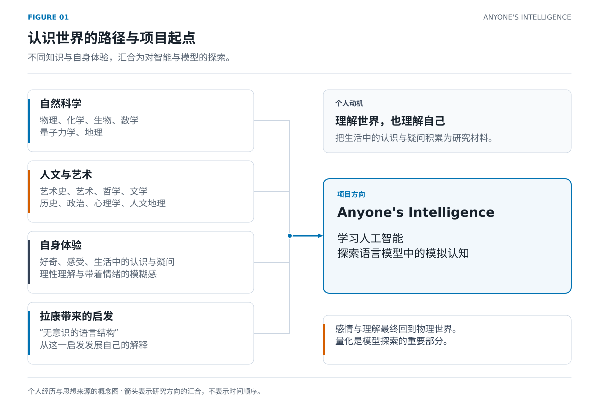
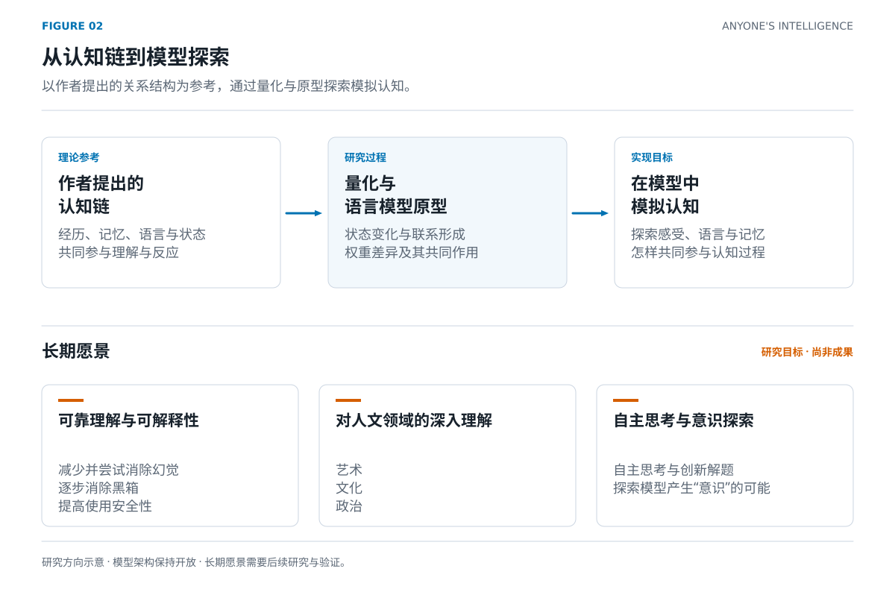
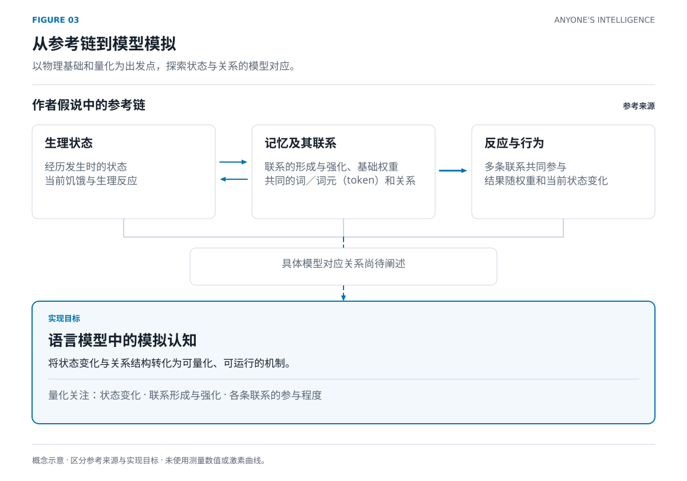
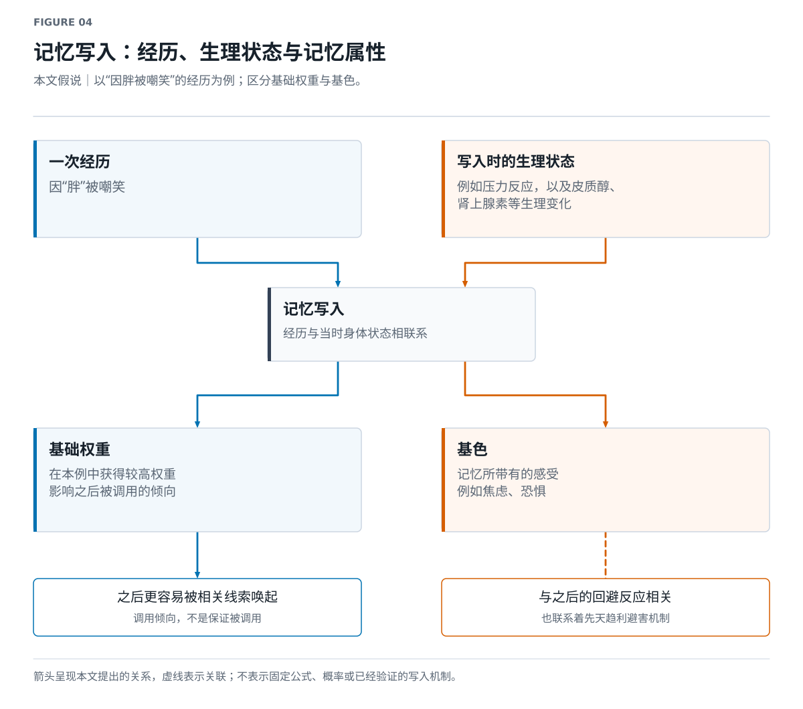
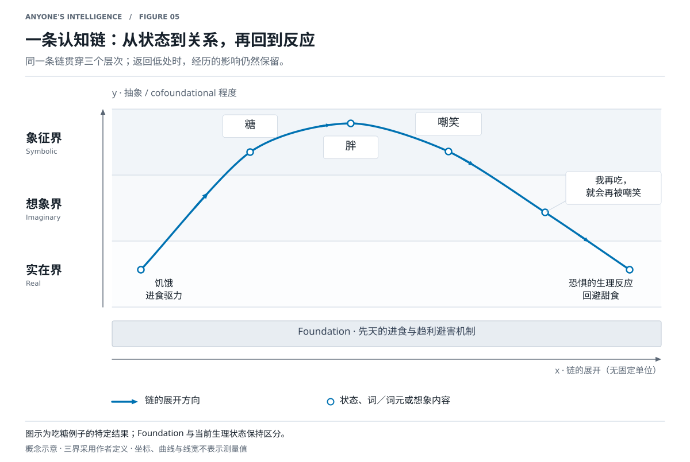
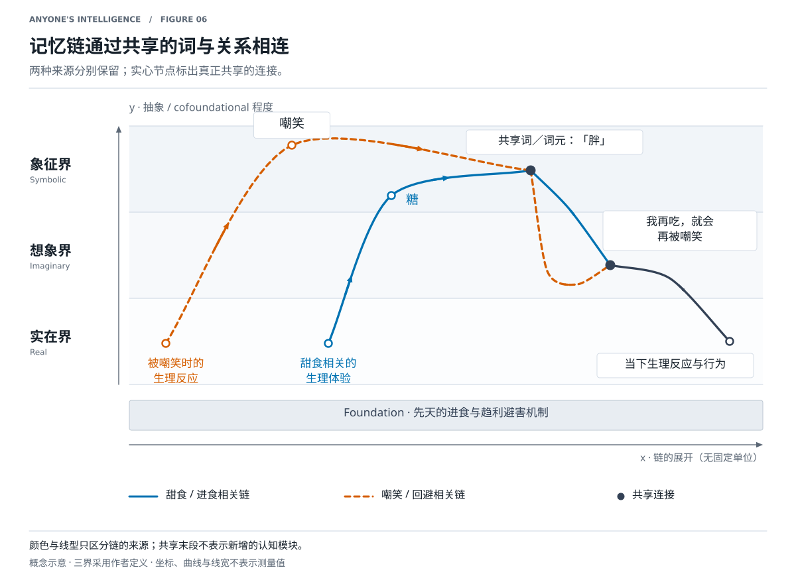
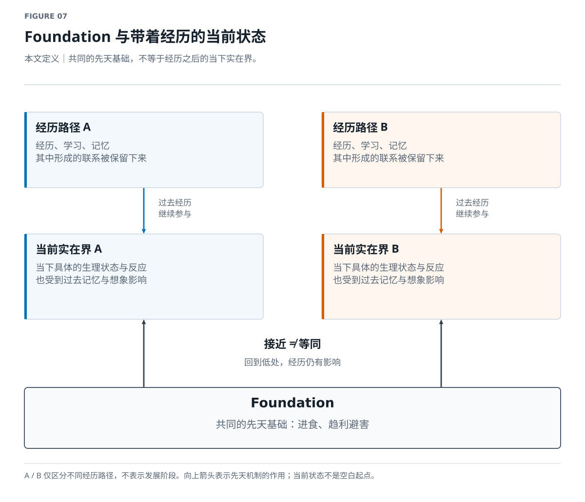
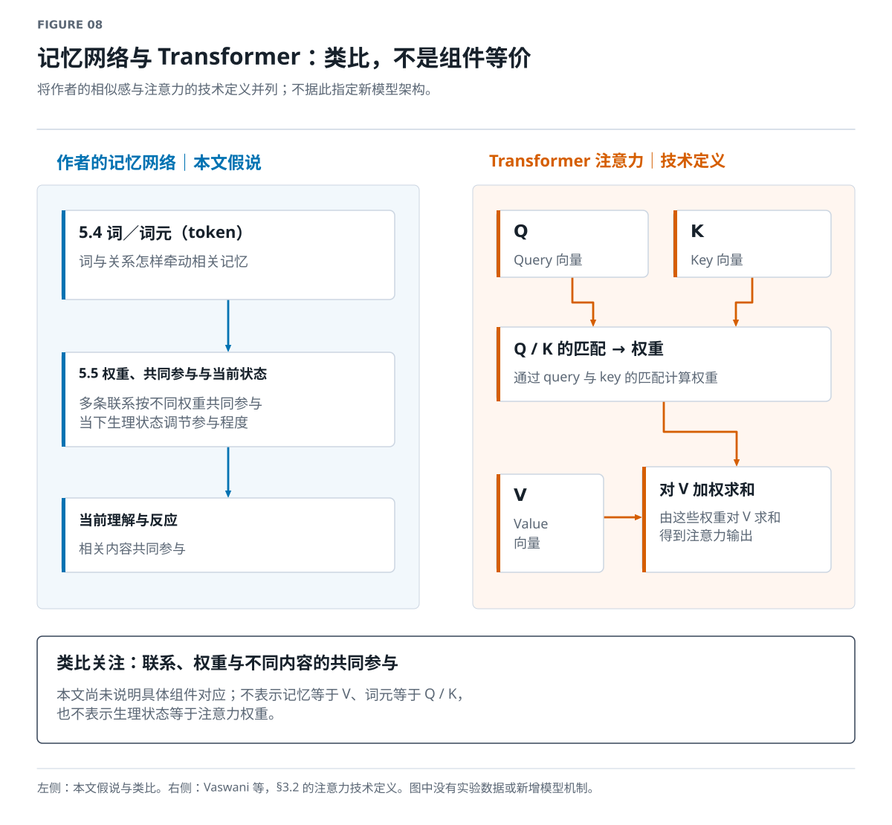
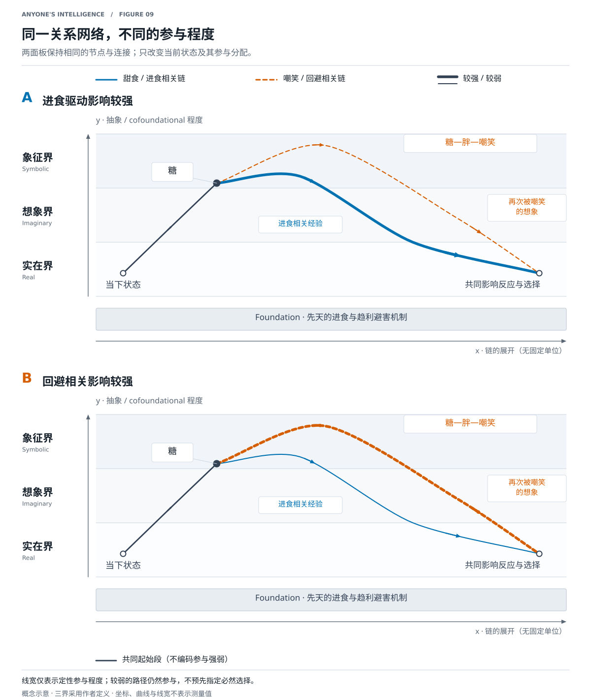

# Anyone's Intelligence

[English](en.md) | **简体中文**

**版本 1.0.1** · 记录时间：**2026-11-07 03:03:42 PST (UTC−08:00)**

文档版本 · America/Los_Angeles · [版本记录](../../CHANGELOG.md)

## 一 摘要

**【研究愿景】**

### 要点

- **我想研究什么**
  - 学习人工智能，参考我提出的认知链，探索实现模拟认知的语言模型原型。
  - 从语言哲学、语言学与拉康精神分析获得启发，发展自己的理论，尝试将它落实为新型语言模型。
  - 长期希望模型形成可靠的理解，深入理解艺术、文化和政治，并能够自主思考、创新解题。
  - 探索模型产生意识的可能，以及消除幻觉和黑箱的方法。
- **【哲学立场／本文假说】我的出发点**
  - 感情、记忆、理解和社会语言的作用，最终都要回到物理世界。
  - 量化是把这条链落实为模型机制的重要部分，涉及状态变化，以及记忆联系的形成、强化和参与程度。
- **【本文假说】我提出的链**
  - 从先天机制出发，通过经历、学习和记忆建立联系。
  - 词和关系连接不同记忆；记忆权重与当下生理状态，共同影响各条联系参与多少。
  - 感受与语言持续相互影响，形成理解，再回到生理反应和行为。
- **【想象／类比】我怎样表达它**
  - x 轴表示链的展开；y 轴越高，越抽象、越 cofoundational。
  - 多条曲线从低处出发，升高、交汇，再回到低处。我借用三界描述层次，也觉得这张网很像 Transformer。

### 叙述

Anyone's Intelligence 是我学习人工智能、探索语言模型中模拟认知的项目。我希望从语言哲学、语言学与拉康精神分析获得启发，在学习和研究中发展自己的理论，参考我提出的认知链构建语言模型原型，探索更可靠、更可理解的人工智能。

**【哲学立场／本文假说】** 我认为，感情和理解最终都要回到物理世界。我想建立或模拟这样一条链：从先天机制和身体状态出发，经过经历、记忆、语言与抽象关系，再回到身体和行为。我的研究重点，是参考这条链，将其中的状态变化和关系结构转化为可量化的模型机制，探索模拟认知的实现。

**【想象／类比】** 我把它想象为一张高低起伏、彼此交汇的曲线网络。它让我联想到语言结构，也联想到 Transformer。下文先讲这些想法从何而来，再按顺序展开我的假说。

> **阅读说明**：「想象／类比」保留直觉与比喻，不表示等价；「本文假说」标记我提出的机制与项目内定义；「学术释义」说明有来源的理论、技术定义或实验观察，不自动代表学界共识或对本假说的验证。标题下的标签默认适用于本节，局部另标。「想象／类比」标签不等于理论中的想象界。
>
> 本文图表均为概念示意，不是测量或模拟结果；目前也没有验证整套假说的实验结论。

## 二 我的自述

**【个人经历】**

### 要点

- **我从小就想理解世界**
  - 接触物理、化学、生物、数学、量子力学、地理，尝试理性地构建认识。
  - 也学习艺术史、艺术、哲学、文学、历史、政治、心理学和人文地理。
- **我为什么不断学习**
  - 对许多学科有所涉猎，但没有深入研究每一科。
  - 相比在单个问题上刨根问底、做出成就，我更害怕“不明不白地活着”。
- **两种体验与一种割裂**
  - 我享受量化、逻辑和归因，也享受人文艺术带来的情绪与模糊感。
  - 我相信世界是物质的，却始终以有身体、有感受的“我”来认识它。
  - **【想象／类比】** “理性的虚拟机运行在感性的系统上”，是我描述这种割裂的比喻。
- **拉康带来的转折**
  - “无意识的语言结构”让我看到连接这些体验的可能。
  - 我希望以此为启发，发展自己的理论。
- **研究重点与个人动机**
  - 重点是学习人工智能，向外研究“智能”与语言模型。
  - 向内理解“我”自己，是伴随研究的个人动机。
  - 把生活中的灵感、认识和疑问记录下来，逐渐积累成研究材料。

### 叙述

我从小就充满好奇，想理解这个世界。我学物理、化学、生物、数学、量子力学、地理，试着理性地建立对世界的认识；也学艺术史、艺术、哲学、文学、历史、政治、心理学和人文地理。这些领域我都有涉猎，初步建立过自己的理解，但没有把每一科都研究得很深。

也许相比盯住一个问题，刨根问底，再做出一番成就，我更害怕“不明不白地活着”。我享受理性世界带来的清楚：万物可以量化，可以找到逻辑，可以追问原因。我也享受艺术、人文，以及我宽泛地称为“形而上学的知识”带来的、夹杂着情绪的模糊感。

**【哲学立场】** 我一直认为世界是物质的。因此，我相信那些感性、模糊、难以说清的现象，最终也能得到因果解释，并以某种方式被量化。但认识世界的始终是“我”：一个有身体、有情绪、有自己经历的人。**【想象／类比】** “理性的虚拟机运行在感性的系统上”，表达的就是我曾感到的割裂，以及对这种割裂的疑惑。

接触哲学，尤其是拉康精神分析中关于无意识与语言结构的思路时，我突然看到了一种连接的可能。感受、语言和身体，似乎可以沿着一条链被继续追踪。我希望沿着这个启发，发展自己的解释。

我知道，人工智能是许多人共同投入的智慧和心血。凭我一个人，几乎不可能完成“让具有认知的人工智能诞生”这样的目标。但我仍然希望学习人工智能，向外研究智能如何形成、模型如何实现。向内理解自己，则是伴随这一过程的个人动机。生活里对一件事的新认识、突然出现的联系、想不通的感受，都值得保存下来，方便日后回看、整理，也方便协作者和 AI 助手读取。

**【个人经历／概念整理】** 图一按来源组织我的学习与思考，展示它们怎样汇合到人工智能研究；不表示具体时间顺序。 [可编辑源](../../assets/figures/01_intellectual_roots.drawio)

## 三 我对 Anyone's Intelligence 的理解

**【研究愿景】**

### 要点

- **以学习人工智能为主线**
  - 学习人工智能与语言模型，探索原型实现。
  - 参考我提出的认知链，通过量化和模型实现来探索模拟认知。
  - 在此基础上探索语言模型的表示、学习和运行机制。
- **我的长期愿景**
  - 让模型形成可靠的理解，减少并最终尝试消除幻觉。
  - 让运行过程可理解、可检查，逐步消除黑箱，提高使用安全性。
  - 探索让模型产生“意识”的可能，以及对艺术、文化、政治的深入理解。
  - 探索自主思考和提出创新解法的能力。
- **模型需要回应的问题**
  - 如何在模型中模拟感受与语言的相互影响，以及记忆参与理解的过程？
  - 怎样将这条链中状态、记忆与选择的关系转化为模型机制？
  - **【想象／类比】** Transformer 提供了网络与权重的参照，最终架构仍然开放。
- **开发边界**
  - 原型默认离线，限制联网和本地 agent 能力。
  - 这是设计要求，实际权限控制仍需实现和验证。

### 叙述

对我来说，Anyone's Intelligence 首先是一个学习人工智能、研究语言模型的项目。核心方向是参考我提出的认知链，在语言模型中实现模拟认知。我希望将这条链中的联系形成、权重差异和状态影响转化为可量化、可运行的模型机制，并通过原型探索它们怎样共同参与认知过程。

我希望模型真正理解，消除幻觉，让内部运行更容易被检查，逐步消除黑箱；也希望它能深入理解艺术、文化和政治，自主思考，提出创新解法，并探索让“意识”诞生的可能。这些是长期愿景。模型流畅地解释自己，并不能因此证明它具有意识或忠实地反映了内部机制。

**【想象／类比】** Transformer 让我找到一种表达网络与权重的参照，但它还不是我为项目确定的架构。**【研究愿景】** 开发也必须考虑安全：原型默认离线，限制联网和本地 agent 能力，以实际权限控制和验证落实这些要求。

**【研究愿景／概念整理】** 图二区分参考来源、量化与原型实现，以及长期愿景；箭头表达研究方向，不表示已实现能力。 [可编辑源](../../assets/figures/02_research_direction.drawio)

## 四 我为什么认为可以量化

**【哲学立场／本文假说】**

### 要点

- **我的物质立场**
  - 感情和理解发生在物理世界中；我认为，它们最终应当能够得到因果解释，并以某种方式被量化。
  - 社会语言的影响，也会通过经历、学习和记忆落实为生理变化。
- **我想建立或模拟的因果链**
  - 经历或输入引起生理变化，这些变化参与记忆写入与关联结构的形成。
  - 后续输入通过既有联系唤起记忆，影响当前生理状态和行为选择。
- **两个例子：生理反应怎样参与记忆**
  - **进食甜食时**：对糖的偏好及进食引起的生理反应，参与相关记忆的形成。我用多巴胺变化来说明这一过程。
  - **因胖被嘲笑时**：压力反应参与记忆写入。在我的假说中，皮质醇、肾上腺素等生理变化会加重这段记忆的基础权重，使它日后更容易被联想到。
- **面向模型实现的量化**
  - 目标：参考这条链及其关系结构，在模型中实现模拟认知。
  - 状态：参考经历发生时和当前生理状态的作用，探索模型中的状态表示与变化。
  - 关联结构：量化记忆怎样相连、联系怎样形成和强化、各自参与多少。
  - 具体的模型对应关系、量化方法与实现方式，尚未在本文展开。

### 叙述

我认为，感情和理解最终都要回到物理世界，因此量化是这项研究的核心。在我的假说中，“喜欢”“恐惧”“避免”等描述可以追溯到生理过程，语言和社会评价也通过记忆的关联结构重新作用于身体。这条链为模型中的模拟认知提供了参考：我希望将其中的状态变化与关系结构转化为可量化、可运行的机制。

吃糖是我最初的例子。设想一个人喜欢甜食，进食伴随多巴胺等生理变化，形成记忆；他也曾因胖被嘲笑，把那次经历与相应的身体反应联系起来。之后听到“甜食会变胖”，“胖”便可能唤起旧记忆，引起恐惧、回避，最后不吃糖。社会语言通过经历、学习和记忆，进入了我想追踪的物理因果链。

我用多巴胺、皮质醇和肾上腺素，是为了具体表达这条思路，并没有把这些简化例子当作已经验证的生理定律。“某种激素越高，记忆就一定越深”也不能直接作为普遍结论。这里的生理机制为建模提供参考；我的研究重点，是借鉴这条链及其关系结构，在语言模型中实现模拟认知。

关联结构同样是量化的重点：为什么一个词使某段经历更容易被联想到？为什么同样的信息，在不同的人或同一个人的不同状态下，产生不同影响？这些问题为建模提供线索。我希望参考联系的形成、强化和参与程度随状态变化的过程，在模型中模拟这条链。

**【本文假说／建模方向】** 图三把作为参考的认知链与模型中的模拟目标并列，具体表示、函数与组件对应仍待阐述。 [可编辑源](../../assets/figures/03_chain_to_model.drawio)

## 五 按顺序展开我的理论

### 5.1 先天的 foundation

**【本文假说】**

#### 要点

- **含义与位置**
  - Foundation 是与生俱来、具有遗传和生理基础的机制，如进食、趋利避害。
  - 它是后续经历影响行为的基础，其动力不全部来自调用其他记忆。
- **与后天经验的关系**
  - 趋利避害有先天基础。
  - 具体接近什么、回避什么，可以受到学习和记忆影响。

#### 叙述

在我的假说中，foundation 指与生俱来、具有遗传和生理基础的机制。饥饿推动进食，趋利避害影响反应；这些是后天经验发挥作用的基础，并不是所有动力都要先用另一段记忆来解释。

在吃糖的例子里，回避痛苦有先天基础，而为什么把甜食与需要回避的事情联系起来，则涉及后天经历。我希望参考这些基础机制与学习、记忆的共同作用，在模型中实现模拟认知。

### 5.2 用已有记忆形成理解

**【本文假说】**

#### 要点

- **理解与 Cofoundational knowledge**
  - 理解一件事，需要拿其他记忆来解释它。
  - 我用 Cofoundational knowledge 描述这种依靠已有记忆和联系形成解释的过程。
  - 此处采用我在项目中的含义，不作为已有文献术语的确定释义。
- **感受与语言的往返**
  - 一个词可以连接旧经历与当前情境，改变感受。
  - 感受又影响哪些内容更容易参与理解，形成新的理解。

#### 叙述

我理解一件事时，需要调用其他记忆，寻找能够解释它的联系。我用 Cofoundational knowledge 表达这种过程：新的信息借助已有联系得到解释，已有记忆由此参与新的理解。

感受和语言在其中不断相互影响。一个词使某段经历与眼前的事情联系起来，改变当下感受；这种感受又影响哪些内容更容易参与理解。这种持续的往返，是我希望在模型中模拟的认知过程。

### 5.3 记忆写入时的生理状态与基色

**【本文假说】**

#### 要点

- **记忆写入与基础权重**
  - 基础权重描述一段记忆在写入时获得、并影响日后调用倾向的分量。
  - 写入时的生理状态参与基础权重的形成。
  - 因胖被嘲笑时，较强的压力反应加重记忆的基础权重，使它更容易被联想到。
- **记忆的“基色”**
  - 我用这个词描述记忆带有的焦虑、恐惧等感受。
  - 它与之后的回避反应有关，回避又联系着趋利避害的先天机制。

#### 叙述

设想一个人因胖被嘲笑。在我的假说中，皮质醇、肾上腺素等生理变化参与记忆写入，使这段经历获得较高的基础权重，之后更容易被相关线索唤起。这是我把经历、身体和记忆连起来的一步。

我用“基础权重”描述这段记忆日后被调用的倾向，用“基色”描述它所带有的感受。这里的基色可能是焦虑、恐惧，并与回避痛苦的反应有关。

> **【学术释义｜实验观察】压力与记忆**
>
> Schwabe 与 Wolf（2014）研究的是记忆提取：压力后 25 分钟和 90 分钟的提取表现受损，而到 90 分钟时皮质醇已回到基线。这提示讨论压力与记忆时需要区分具体任务和阶段；该实验没有检验我提出的“写入时生理状态—基础权重”机制，不能直接确认或否定它。[论文原文](https://www.psy.uni-hamburg.de/arbeitsbereiche/kognitionspsychologie/publikationen-alt/schwabe2014a-cabn.pdf)

**【本文假说／概念图示】** 图四区分经历、生理状态、基础权重与基色；箭头表示假说中的作用关系，不给出固定的生理定律或权重公式。 [可编辑源](../../assets/figures/04_memory_encoding.drawio)

### 5.4 词和关系怎样连接不同记忆

**【本文假说】**

#### 要点

- **共同的词与关系**
  - 这里的“词”也指向模型中的词元（token）。
  - 不同记忆通过共同的词或关系连接。
  - “胖”可以连接“甜食会变胖”与“因胖被嘲笑”。
- **【想象／类比】与 Transformer 的相似之处**
  - 我觉得这种连接过程很像 Transformer：词／词元通过与其他内容的关系，影响相关记忆参与当前理解的权重。
  - “胖”连接不同经历，并使被嘲笑的记忆更容易参与当前过程，是我理解这种相似性的例子。
- **因果联系与关系乘数**
  - “胖—被嘲笑”在经历中形成因果联系，影响之后的联想。
  - 我用“乘数”描述这种关系对基础权重的作用，进而说明这段记忆在当前联想中的参与程度。
  - 这是被学习、被记住的因果联系；它是否符合外部事实，需要另行判断。
- **用语**
  - “词／词元（token）”在这里描述语言联系；本文尚未说明具体的分词方式与模型表示。

#### 叙述

一个人已有因胖被嘲笑的记忆，再学到“甜食会变胖”时，“胖”便成为连接点。这里的“词”也指向模型中的词元（token）。之后面对甜食，相关信息就可能沿着这条联系，唤起被嘲笑的经历。

**【想象／类比】** 我觉得这个过程很像 Transformer：词／词元通过与其他内容的关系，影响相关记忆在当前理解中参与多少。这是我从记忆之间的连接和加权参与联想到 Transformer 的地方；具体的模型组件对应仍需在后续阐述中说明。

记忆有在经历中形成的基础权重，当前信息与记忆之间的关联则进一步影响它的参与程度。我用“乘数”描述这种关系对基础权重的作用。在这个例子里，被记住的“胖—被嘲笑”因果联系，使相关记忆更容易参与当前联想。被记住的因果联系是否符合外部事实，则是另一个问题。

### 5.5 多条联系共同参与当前反应

**【本文假说】**

#### 要点

- **激活不是简单的开关**
  - 不是一条联系激活，其他联系就全部休眠。
  - 多条联系同时参与，权重影响各条联系的参与程度。
- **【想象／类比】Transformer 的另一个参照角度**
  - 我也把多条联系按不同权重共同参与，理解为与 Transformer 相似的过程。
  - 5.4 侧重词／词元怎样牵动相关记忆；这里侧重这些联系怎样分配参与程度、共同影响反应。
- **当前状态的调节作用**
  - 很饿时，进食驱动力较强。
  - 被嘲笑的记忆较为深刻时，相关回避作用可能较强。
  - 行为选择具有状态依赖性：同一个人面对同一块糖，也可能因当前状态不同而作出不同选择。

#### 叙述

我把激活理解为程度问题。面对一块糖，进食相关的经验和被嘲笑的记忆可以共同参与，权重影响各条联系的参与程度。

**【想象／类比】** 这一点也让我联想到 Transformer，但它与上一节的参照角度不同：上一节侧重词／词元与相关记忆之间的联系，这里侧重多条联系的加权共同参与。当前状态如何调节这种参与，是我希望在模型中模拟的关系；本文尚未给出它与 Transformer 具体计算部件的对应。

当前生理状态也起调节作用：很饿时，进食驱动力更强；被嘲笑的记忆较为深刻时，回避的影响可能更强。因此，行为选择具有状态依赖性，同一个人面对同一块糖也可能产生不同结果。我希望参考这种状态依赖关系，在模型中量化并模拟记忆权重与当前状态对选择的共同影响。

### 5.6 用 x 与 y 表达链的展开和抽象程度

**【本文假说】**

#### 要点

- **x 轴：链的展开**
  - 暂时没有具体单位，也不等同于固定刻度的时间轴。
  - 也用于描述这类过程在个人经历中的多轮展开。
- **y 轴：抽象程度**
  - 低处接近 foundation；越高越抽象、越 cofoundational。
  - 中间的词与联系越多，链越长、越复杂，对应更高的层级。
- **【想象／类比】曲线的形态**
  - 从低处出发，中间升高，再回到低处。
  - 形状表达关系，不预设具体函数、距离或数值。

#### 叙述

我用 x 轴表示链怎样展开，先不规定单位；我也借它表达一个人已经历过多轮这种过程。y 轴表示抽象程度：低处接近 foundation，越高越 cofoundational，经过的中间词和联系更多，链也更长、更复杂。

**【想象／类比】** 在二维图上，我想象一条曲线从低处出发，向上经过抽象关系，再返回低处的生理反应与行为。这样，身体与抽象理解就能在同一条链上被追踪。曲线的高低起伏表达的是这个想法，并非已经求出的函数。

### 5.7 象征界、想象界、实在界

**【本文假说】**

#### 要点

- **象征界：最高、最抽象**
  - 在例子里是“糖—嘲笑”的关系，“胖”是其中的连接。
- **想象界：连接上下**
  - “我再吃，就会再被嘲笑。”
  - 抽象关系被放入与自身有关的想象情境，连接象征界和实在界。
- **实在界：靠近 foundation**
  - 当下具体的生理状态和反应，如饥饿、激素变化。
  - 记忆和想象可以影响这些状态，继而影响行为。
- **术语来源**
  - 我借用拉康的三个名称，赋予它们本项目中的含义。
  - 这里的生理解释和纵向排序属于我的假说。

#### 叙述

我借用象征界、想象界和实在界，把 y 轴分为三大层。象征界最高、最抽象：在这个例子里，“糖—嘲笑”表达了抽象关系，“胖”把不同经历中的内容连起来。

想象界连接上下。“我再吃，就会再被嘲笑”，将“糖—胖—嘲笑”这条关系代入了与自己有关的情境。这样的想象可以引起恐惧和生理变化，影响是否继续吃糖。这里的实在界，指当下具体的身体状态和反应。链由此经过词与关系、与自身有关的想象，再落实到生理和行为。

> **【学术释义｜拉康理论文本】三界的名称与本文用法**
>
> 拉康在《RSI》1974 年 12 月 10 日讲座中，提出从“严格不可思”的角度切入实在界。这与我把实在界解释为当前生理状态不同；本项目对三界的纵向排序及生理映射，应按我的定义理解。[原文节选](https://www.freud-lacan.com/documents-ged/extraits-du-seminaire-xxii-de-jlacan-rsi-2/)

**【想象／类比｜概念图示】** 图五呈现一条链的展开。两端是具体状态，下方的 foundation 表示先天机制；坐标位置、层宽和曲线形状仅作概念示意。 [可编辑源](../../assets/figures/01_single_chain.drawio)

### 5.8 不同链在不同层级相交

**【本文假说】**

#### 要点

- **交点表示联系**
  - 不同记忆通过共同的词或关系相连。
  - “胖”连接了甜食相关信息与被嘲笑的记忆。
- **多条链形成网络**
  - 联系可以发生在不同层级，各自以不同程度参与当前过程。
  - 图中交汇表示记忆联系，不表示已测得的统计相关或外部因果效应。

#### 叙述

不同记忆通过共同的词或关系连接，在图上表现为曲线相交。“胖”把吃糖和被嘲笑联系起来，使不同情境中形成的内容参与同一次反应。

这些连接可以出现在不同层级，逐渐构成一张网。权重与当前状态共同影响每条联系参与多少。图中用交点表达联系，部分中间过程则先作省略。

**【想象／类比｜概念图示】** 图六用颜色与线型追踪记忆链，用实心节点标出共享的词或关系。颜色与线型用于区分来源，不表示互斥模块。 [可编辑源](../../assets/figures/02_intersecting_memory_chains.drawio)

### 5.9 Foundation 与经历后的实在界

**【本文假说】**

#### 要点

- **Foundation 是先天机制**
  - 人的共同基础，如进食、趋利避害。
  - **【想象／类比】** 我借“所有人”或“婴儿”说明这个起点。
- **实在界是带着经历的当前状态**
  - 它受先天机制作用，也受记忆、学习和想象影响。
  - **【想象／类比】** 我借“阉割后的人”作比喻，也就是已经历过多轮这种过程的人。
- **回到低处，不等于清空经历**
  - y 再次降低，表示回到生理反应和行为。
  - 过去的经历仍然影响之后的过程，因此实在界接近但不等于 foundation。

#### 叙述

Foundation 与实在界接近，但不相同。前者是与生俱来的基础机制，后者是一个人当下具体的身体状态和反应。这个人已经有经历、有记忆，也受想象影响，因此当前状态带着历史。

**【想象／类比】** 我曾借“婴儿”和“阉割后的人”说明这个区别。放在我的图里，后者更直接地意味着：已经经过了多轮曲线。这些是帮助我表达的比喻，不据此推导额外的发展阶段或拉康理论结论。

无论之前经过怎样的抽象关系，链最终仍回到身体和行为，但不会因此退回未经经历影响的状态。这就是我把实在界放在靠近 foundation 的地方，却不把二者合并的原因。

**【本文假说／概念图示】** 图七区分先天基础、经历过程与当前状态；经历的作用被保留，接近 foundation 不等于返回空白起点。 [可编辑源](../../assets/figures/07_foundation_and_history.drawio)

### 5.10 我的类比与想象

**【想象／类比】**

#### 要点

- **这张网很像 Transformer**
  - 词和其他内容通过联系形成网络，权重影响相关内容参与多少。
  - “胖”使被嘲笑的记忆更容易参与当前过程，是这种相似感的例子。
  - 不同输入和当前状态牵动不同联系，让我想到它与语言模型的可能联系。
- **理性虚拟机与感性系统**
  - 这个比喻表达我曾感到的割裂，促使我寻找感受、语言与物理过程之间的联系。
- **语言结构与曲线网络**
  - “无意识的语言结构”是重要启发，我希望在此之上发展自己的解释。
  - 起伏、交汇的曲线把生理、记忆、抽象和行为放在一起，多轮曲线留下经历。
- **这些想象的作用**
  - 保留这些想象，有助于追溯问题和假说的形成过程，为研究提供方向。
  - 相似感还不等于架构选择、组件对应或实现证据。

#### 叙述

我觉得这张网很像 Transformer。一个词能够牵动其他内容，不同联系具有不同分量，这些分量影响哪些内容参与眼前的反应。比如，“胖”让被嘲笑的记忆更容易被联想到。我正是通过这样的例子，把自己的记忆网络想象与语言模型连起来。

我想保留这份相似感，并继续追问：理解中的词、记忆、联系和权重，与已有语言模型之间会有哪些对应和区别？

“理性的虚拟机运行在感性的系统上”，以及从“婴儿”到“经过多轮链条的人”，帮助我说出了自己的问题；“无意识的语言结构”又让我看到连接这些问题的路线。我希望保留想法形成时的样子，也保留后续阐释与修订的空间。

> **【学术释义｜技术定义】Transformer 的注意力**
>
> 原论文把注意力描述为对 value 向量加权求和，权重由 query 与 key 的匹配关系计算。这是类比所参考的技术机制；把它与经历、记忆和生理状态建立对应，是我自己的研究问题。[Vaswani 等，§3.2](https://arxiv.org/html/1706.03762v7#S3.SS2)

> **【学术释义｜拉康理论文本】无意识与语言结构**
>
> 拉康在《研讨班 IX》1962 年 1 月 10 日讲座中，讨论无意识层面的思想在一定层面上具有语言般的结构，同时指出它们不容易直接用日常语言表达。这是精神分析理论主张；本项目的记忆权重、生理链和量化路径是我的延伸。[原文英译，页 76](https://www.lacaninireland.com/web/wp-content/uploads/2010/06/THE-SEMINAR-OF-JACQUES-LACAN-IX.pdf#page=76)

**【想象／类比与学术释义对照】** 图八分别标出 5.4 的词／词元关联与 5.5 的加权共同参与，并列参照 Transformer 注意力；两侧不构成已确定的组件映射。 [可编辑源](../../assets/figures/08_transformer_analogy.drawio)

### 5.11 把吃糖的例子完整连起来

**【本文假说】**

#### 要点

- **基础动力与已有经历**
  - 进食、趋利避害等先天机制提供基础，当前饥饿程度影响进食驱动力。
  - 设想某人曾因胖被嘲笑；当时的生理状态加重记忆的基础权重，留下焦虑、恐惧的基色。
- **学习与连接**
  - 后来学到“甜食会变胖”，“胖”连接甜食信息与被嘲笑的记忆。
  - “糖—胖—嘲笑”形成词与关系链；我用关系乘数描述这些联系对记忆基础权重的作用。
- **想象、生理与行为**
  - “我再吃，就会再被嘲笑”的想象引起恐惧及生理反应，并影响回避行为。
  - 进食与回避相关联系同时参与，结果受权重与当下状态共同影响。
  - 在这个例子中，结果是不吃糖；状态改变，结果也可能改变。

#### 叙述

把前面的内容放回同一个例子：一个人具有进食、趋利避害的基础机制，也曾因胖被嘲笑。在我的假说中，当时的生理变化加重了这段记忆的基础权重，并留下焦虑、恐惧的基色。后来，他学到“甜食会变胖”，“胖”便把这句话和过去的经历连起来。

再次面对糖时，“糖—胖—嘲笑”的联系参与反应，我用关系乘数描述这些联系对记忆基础权重的作用。他可能想象“我再吃，就会再被嘲笑”，产生恐惧和相应的生理变化。趋利避害的基础机制通过后天形成的联系作用于行为，在我设想的这个例子中，这些作用最终使他没有吃糖。

其他联系仍然参与其中。如果他很饿，进食驱动力也会增强。因此，有这段记忆不等于一定拒绝甜食。我希望参考这一过程，在模型中量化各条联系的参与程度及其随当前状态的变化，用于模拟认知。

**【想象／类比｜概念图示】** 图九展示两种可能的参与分配。线宽定性表示较强或较弱的参与，不是概率、百分比或计算结果；所有路径都保留，也不预先指定行为上的必然胜者。 [可编辑源](../../assets/figures/03_state_dependent_participation.drawio)

### 5.12 讨论中提出、待进一步说明的问题

**【待讨论】**

#### 要点

- **概念与对应关系**
  - 基础权重、关系乘数、基色和行为作用程度怎样对应。
  - 生理状态通过什么具体关系参与这些过程。
- **坐标的精确定义**
  - 抽象程度、中间词的数量、链长及复杂度怎样确定 y 的排序。
  - x 的展开和多轮过程怎样获得更明确的描述。
- **讨论中提出、待我回应的问题**
  - 最初的经历怎样写入，与理解及 foundation 有什么关系。
  - 想象引起的生理反应是否以及怎样再次参与记忆写入。
  - 怎样区分理解与误解，高权重与符合外部事实之间是什么关系。
  - 这些提问不表示我已认可其中的前提，也不由整理者代我回答。
- **当前状态与相关文档**
  - 内部讨论暂未识别出明确成立的自相矛盾；这不是一致性证明或实证支持。
  - [早期研究计划](../RESEARCH_PLAN.md)包含候选实验设计，不作为本文假说的既定内容。
  - 开发要求见[安全规范](../SAFETY.md)，协作约定见[AGENTS.md](../../AGENTS.md)。

#### 叙述

这次阐述已经连起先天机制、经历、记忆、语言、想象与身体反应。进一步说明时，需要讲清不同权重和生理状态怎样对应，以及坐标如何表达抽象程度和多轮经历。这里列出的是尚未在本文完整展开的内容，不能据此判断我是否已经形成相关想法。

关于最初记忆、想象是否再次影响写入、理解与误解的区别，也有一些讨论中提出、等待我回应的问题。它们先作为提问保留，不代表我认可全部前提。现有讨论没有发现明确成立的自相矛盾，但整套假说的一致性和经验依据，仍需分别研究。
